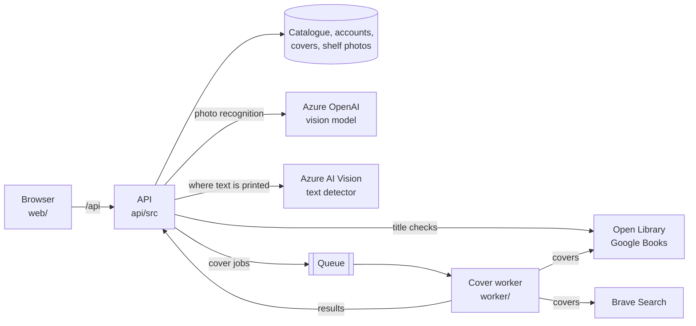

# Pince

**A family library · Biblioteca familiei.** Pince is a small, private reading catalogue for one family, in Romanian and English. A parent and a child add the books on their shelves, mark what they have read, keep private notes, and send a friend a public, read-only link to a single book.

It was built for a home library of about 500 books, many of them Romanian children's editions that the usual book catalogues do not know. It runs on your own computer with no cloud account, in a container on a home server, or on Azure for a few dollars a month.

> This is a personal project shared as it is. It is built around one family's needs (two accounts, one library) and is not a multi-tenant service.

The name comes from Madam Pince, the librarian in the Harry Potter books. Pince is an independent project and is not affiliated with or endorsed by the author or publishers of those books.

## What it does

- **Four ways to add books**
  - type the title;
  - photograph one cover;
  - photograph a shelf, and get one row per spine;
  - photograph several front covers laid out on a table, and get one row per book with its own cover cut from the photo.
- **You confirm everything.** Text read from a photo is checked against Open Library and Google Books, and nothing is saved until you accept or correct each row.
- **Covers.** A book keeps the cover you photographed or uploaded. Otherwise up to two suggestions are found in the background from Open Library, Google Books and, optionally, bookshop and publisher pages through Brave Search.
- **A bookshelf to browse.** Search, sort, and filter by favourites, read or unread, with or without a cover, lent out, and by the shelf photo a book came from.
- **A reading log.** A book marked as read keeps the day it was finished and a rating from one to five. The bookshelf counts the books finished this year and can sort by the latest finished.
- **Lending.** Note who has a book and since when, and see at a glance which books are away from home.
- **A wishlist.** Books you want but do not have are kept apart from the shelf. When one arrives, one button moves it to the shelf.
- **Sharing.** Each book has a public address showing only its title, author and chosen cover. The parent can also switch on one public link to the wishlist, for people looking for a present, and switch it off or replace it at any time. Notes, reading status, loans and shelf photos stay private.
- **Two accounts.** The parent can also delete books, manage both accounts, switch photo recognition on or off, watch the estimated cost, and download or restore a backup.
- **Spending limits.** Photo recognition stops by itself at fixed monthly and yearly amounts.

The [user guide](docs/USER-GUIDE.md) walks through each of these.

## How it works



- The **browser app** in `web/` is plain HTML, CSS and JavaScript modules, with no build step and no framework.
- The **API** in `api/src/` is one request handler. On your computer it is served by a small Node script with SQLite; on Azure it runs as the managed API of a Static Web App with Table and Blob Storage.
- The **cover worker** looks for covers after a book is saved, so saving never waits on another website.
- Every outside service is optional. Without any of them you can still type titles and upload covers.

[Architecture](docs/ARCHITECTURE.md) describes the parts, the data, the API and the photo pipelines in detail.

## Run it on your computer

You need [Node.js 22](https://nodejs.org/).

```sh
npm run setup
npm start
```

On the first start the terminal shows a one-time **set-up link**. Open it to choose the names and passwords of the two accounts, parent and child, and to add the keys of the optional services, each checked before it is saved. Every step can be skipped: without the link, open <http://127.0.0.1:46173> and sign in as **parinte** (parent) or **copil** (child) with the generated passwords in `.library/local-access.json`. The catalogue and its images are kept in `.library/`, which git ignores.

**În română.** Instalează Node.js 22, rulează cele două comenzi de mai sus și deschide biblioteca locală. La prima pornire, terminalul afișează un link de configurare: deschide-l pentru a alege numele și parolele celor două conturi și pentru a adăuga cheile serviciilor opționale. Dacă sari peste el, numele de utilizator și parolele generate se găsesc în `.library/local-access.json`. Pentru a trimite o carte unui prieten, deschide cartea și alege **Distribuie cartea**; linkurile devin accesibile altora când aplicația este găzduită în Azure.

`npm run doctor` checks that the computer is ready, and `npm run backup` writes the whole library to one file. [Running locally](docs/LOCAL.md) covers settings, backups, upgrades and troubleshooting.

Photo recognition and cover lookups need keys for outside services. Add them in the set-up screen, or later in **Family settings**. [Configuration](docs/CONFIGURATION.md) lists every setting and where each one is kept.

## Run it in a container

```sh
docker run -d --name pince -p 127.0.0.1:46173:46173 -v pince-data:/data ghcr.io/danadrianparaschiv/pince:1
docker logs pince
```

The log shows the address and a one-time set-up link. The image is published with every release, for x86-64 and ARM64. [Running in a container](docs/DOCKER.md) covers versions, a home server with HTTPS, data and upgrades.

## Put it on Azure

```sh
./scripts/deploy.sh setup
```

The script checks this computer, then asks one question at a time: the subscription, the resource group and region, the two account names and their passwords (typed without being shown), whether to add photo recognition, and an address for cost alerts. Nothing is created before you confirm at the end. It then creates the resources, publishes the app, checks the result, and offers to store the two optional keys for cover lookups. `./scripts/deploy.sh init --with-vision` does the same without questions, from settings in your environment. `doctor` checks the prerequisites on its own, `status` shows what is deployed, `keys` adds or replaces the optional keys, and `destroy` removes the library. [Deployment and costs](DEPLOY.md) covers prerequisites, settings, the optional services, budgets and what a month typically costs.

## Tests

```sh
npm test
```

The tests run offline in a few seconds and cost nothing: every outside service is replaced by a stand-in, and the run fails if anything reaches for the network. They cover sign-in and sessions, public links, image handling, concurrent edits, both storage back ends, the scan and cover pipelines, spending limits and a 500-book catalogue.

`npm run check` adds a formatting check of the test suite and minimum coverage levels, and `npm run smoke` starts the library and uses it. CI runs these on Linux, macOS and Windows for every push and pull request; see [CI and delivery](docs/CI-CD.md). [The test guide](test/README.md) explains how the suite is organised and what it deliberately leaves out.

## Where things are

| Path | What is there |
| --- | --- |
| `web/` | The browser app: bookshelf and book pages (`app.js`), adding books (`import.js`), family settings (`parent.js`), setting up a local library (`setup.js`), labels in both languages (`strings.js`) |
| `api/src/` | The API: routes (`app.js`), accounts (`auth.js`), books and covers, photo scans, catalogue checks, cover lookups |
| `worker/` | The background cover worker's entry point; it reuses the lookup code in `api/src/` |
| `scripts/` | Local server, its set-up screen, health check and backup; Azure deployment; helpers that store service keys |
| `infra/` | Bicep templates for the Azure resources |
| `Dockerfile`, `docker/` | The container image of the local library, published with every release, and a Compose example that puts it behind HTTPS |
| `test/` | The test suite, its helpers and fixtures; see [the test guide](test/README.md) |
| `docs/` | User guide, architecture, configuration and the original requirements |

## Privacy and outside services

- **Secrets are never in this repository.** Keys, passwords and connection strings are read from the environment or from Azure at run time. See [SECURITY.md](SECURITY.md).
- **Your books stay yours.** The catalogue, covers and shelf photos live in your own storage. The public page of a book, and the wishlist link if you switch it on, show title, author and cover and nothing else.
- **What leaves your library.** A photo you choose to scan goes to your own Azure OpenAI and Azure AI Vision resources. Titles, authors, publishers and ISBNs go to Open Library, Google Books and Brave Search to find details and covers. Nothing else is sent, and none of these services is contacted unless you configure it.
- **Cover images** belong to their publishers. They are stored in your private library for your family's use and are not part of this repository.
- Book details and some covers come from [Open Library](https://openlibrary.org/) and [Google Books](https://books.google.com/); Google Books results carry Google's attribution in the app.

## Documentation

- [What is supported](docs/SUPPORT.md): the three ways to run Pince, how they differ, and how to get help
- [Running locally](docs/LOCAL.md): install, settings, backups, upgrades, troubleshooting
- [Running in a container](docs/DOCKER.md): building the image, a home server with HTTPS, data, upgrades
- [User guide](docs/USER-GUIDE.md): adding books, covers, sharing, filters, family settings
- [Architecture](docs/ARCHITECTURE.md): parts, data, API, photo and cover pipelines
- [Configuration](docs/CONFIGURATION.md): every setting, and where secrets are kept
- [Deployment and costs](DEPLOY.md): Azure setup, optional services, budgets
- [CI and delivery](docs/CI-CD.md): the GitHub Actions workflows, releasing, deploying to Azure from GitHub
- [Contributing](CONTRIBUTING.md): working on the code, tests, the recognition benchmark
- [Security](SECURITY.md): reporting a problem, how the library protects its data
- [Requirements](docs/REQUIREMENTS.md): the original functional requirements, in Romanian and English

## Licence

The code is released under the [MIT License](LICENSE).

The licence covers the code and documentation in this repository. It does not cover book covers or catalogue data fetched from other services, the Google Books attribution image in `web/`, or the content of anyone's library.
